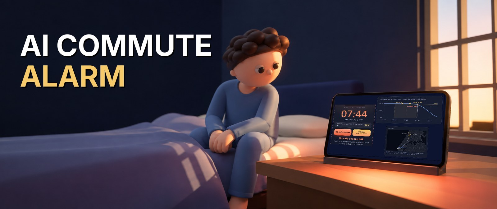
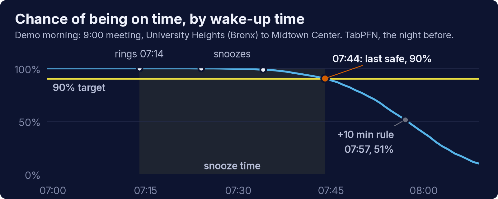
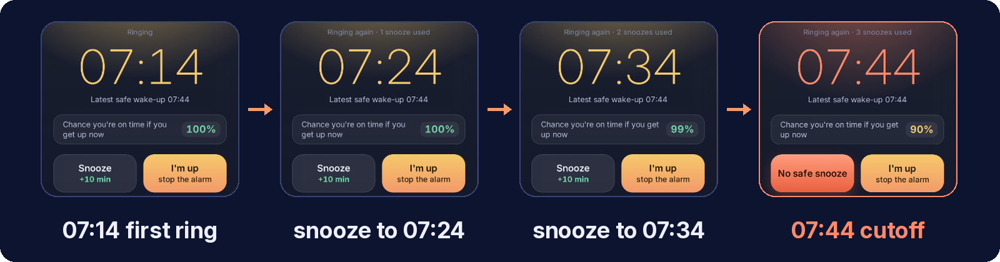
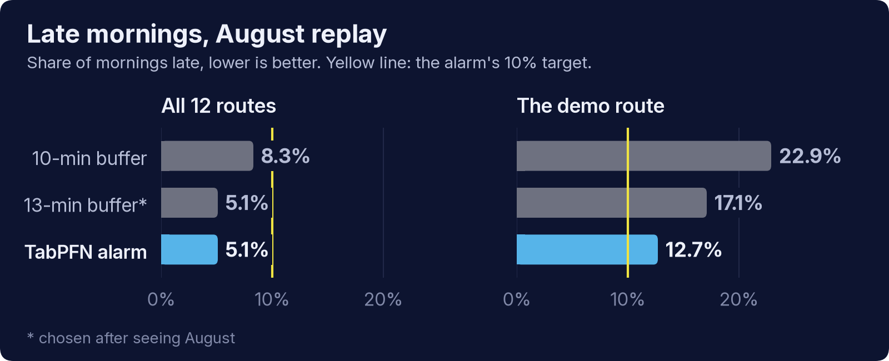

# Snooze Oracle



[](LICENSE)
[](https://snooze.eliasshieh.com)
[](https://youtu.be/HcZXvemBTq8)
[](https://dev.to/elias-shieh/my-alarm-wont-let-me-snooze-if-id-be-late-42p0)

An alarm that works out, the night before, the latest time you can get up and still be on
time with an estimated 90% probability. It rings 30 minutes earlier and allows snoozes of up
to 10 minutes until that cutoff, then refuses.

Two mornings are covered:

- **Commute:** an Uber to a meeting in Midtown, the Financial District or Hudson Yards.
- **Pickup:** meeting someone off an early flight (landing 03:00–08:59) at JFK or LaGuardia.

Ride times come from TabPFN-3.5 run locally on NYC TLC Uber trips; flight delays from
TabPFN-3.5 on BTS on-time data.

**Try it:** <https://snooze.eliasshieh.com> replays six August 2026 mornings (four commutes,
two airport pickups) with a simulated alarm clock and a map of each route. The page is
static: the curves were precomputed and nothing on it calls a model.

Built for the [DEV Hacktoberfest Open-Source AI Challenge, Week 3](https://dev.to/challenges/hacktoberfest-week3-2026-10-19).
The write-up is on [DEV](https://dev.to/elias-shieh/my-alarm-wont-let-me-snooze-if-id-be-late-42p0).

## How it works


For each possible wake-up time, the planner simulates 2,000 mornings: getting ready (about
15 minutes, an assumption) and the ride, plus the flight's delay and 20 minutes to leave the
airport for a pickup. TabPFN gets up to 10,000 July trips as examples: trips on the same
route around the requested hour first, then trips from the same borough to the same
destination. It is not trained or fine-tuned.



On the demo page the alarm plays this out: three 10-minute snoozes, then it refuses.



## Results

Every strategy picks one wake-up time the night before and is scored against what really
happened in August 2026. The models only saw July.



| Share of mornings late | Airport | Commute | Demo route |
|---|---|---|---|
| Fixed buffer* | 11.1% | 8.3% | 22.9% |
| Lookup alarm | 9.1% | 6.1% | 21.3% |
| LightGBM alarm | 11.7% | 6.6% | 14.6% |
| TabPFN alarm | 10.3% | 5.1% | 12.7% |

\*30 minutes for the airport, 10 for the commute. The demo route is University Heights
(Bronx) to Midtown Center, which has few Uber trips.

- Across the 12 commute routes, the alarm got you up 2.9 minutes earlier on average than the
  10-minute buffer. A 13-minute buffer matched its overall late rate, but you could only pick
  13 after seeing August.
- On the demo route the alarm is still above its own 10% target.
- At the airport, the lookup alarm did better than TabPFN.
- On rare routes, with the same rows for all three, TabPFN's ride-time pinball loss was 2.49
  minutes against 2.78 for LightGBM and 2.97 for the lookup table.

Full reports: [commute backtest](docs/commute_backtest.md),
[airport backtest](docs/backtest.md), [ride model comparison](src/ride/RESULTS_round3.md),
[flight models](src/flight/RESULTS_round2.md), [findings](docs/findings.md).

## Quickstart: run the planner

The planner reads precomputed tables only: no GPU, no model call, under 2 seconds. The tables
are not in git, so build them first (see [Rebuild everything](#rebuild-everything)).

```bash
python -m src.agent index      # once, after the tables exist
python -m src.agent plan --scenario commute --from "Cobble Hill" --to "Midtown North" --deadline 09:00
python -m src.agent flights --airport JFK --date 2026-08-12
python -m src.agent plan --scenario pickup --flight DL709 --airport JFK --from "South Ozone Park"
python -m src.agent demo       # rebuilds docs/demo/index.html
```

It writes `out/plan.json` (wake time, first ring, latest time to request the ride,
probability of being on time, and the lookup-table and fixed-buffer alternatives) and
`out/alarms.ics` (a first ring 30 minutes before the wake time and a final alarm at it). To
get the alarms onto a phone, see [docs/phone.md](docs/phone.md).

Place names are fuzzy-matched to TLC taxi zones; when a name fits several zones you are
asked to choose. Only precomputed routes work:

- commute: 12 routes, listed in [docs/commute_backtest.md](docs/commute_backtest.md);
- pickup: 8 pickup zones per airport, listed in [src/alarm/README.md](src/alarm/README.md),
  and the August flights that `python -m src.agent flights` lists.

### Replay dates

The public data ends in August 2026, so "tomorrow" is a replay: the planner plans a morning
in August 2026 (default 2026-08-12, a Wednesday) using only what was known the night
before. The `.ics` file puts the same clock times on a real date (`--alarm-date`, default
tomorrow on your computer) so the alarms can ring.

## Rebuild everything

Python 3.11 or 3.12. TabPFN steps need a CUDA GPU. On WSL with a driver that supports
CUDA 12.6, install torch from the cu126 index after the requirements (see [SPEC.md](SPEC.md)).

```bash
python -m venv .venv && .venv/bin/pip install -r requirements.txt
python scripts/prep_trips.py 2026-07 2026-08
python scripts/prep_flights.py --no-report 2025-08 2025-09 2025-10 2025-11 2025-12 2026-01 2026-02 2026-03 2026-04 2026-05 2026-06 2026-07 2026-08
```

Then follow the reproduce sections in [src/flight/RESULTS_round2.md](src/flight/RESULTS_round2.md),
[src/ride/RESULTS_round3.md](src/ride/RESULTS_round3.md) and [src/alarm/README.md](src/alarm/README.md),
and `python -m src.alarm.commute commute-routes|tables|run|report` for the commute tables.
TabPFN steps take the lock in `/tmp/snooze-oracle-gpu.lock` themselves.

## Project layout

```text
src/ride/      ride-time models: TabPFN with retrieval context, LightGBM, lookup table
src/flight/    flight delay and cancellation models
src/alarm/     Monte Carlo alarm, airport and commute backtests
src/agent/     command-line planner, .ics export, demo page builder
scripts/       data download and preparation
docs/          backtest reports, charts, the static demo (docs/demo) and figure sources
SPEC.md        definitions and decisions behind every number
```

## Limitations

- It is a replay and a planner, not a phone app: the snooze refusal exists only on the demo
  page. The calendar export schedules two ordinary alarms.
- It does not know about tomorrow's accident or weather. It learns how a weekday morning at
  that hour usually goes on a route, and how much it varies.
- One month of test data. Routes with few trips borrow ride samples from any August weekday.
- Getting ready (15 minutes) and leaving the airport (20 minutes) are assumptions.

## Contributing

Issues and pull requests are welcome. See [CONTRIBUTING.md](CONTRIBUTING.md).

## TabPFN-3.5 license

TabPFN-3.5's weights are free under Prior Labs' non-commercial license; you accept it once
at first use and the weights are cached on your machine. The weights are not in this
repository, and Snooze Oracle does not offer a hosted prediction service: the public demo
uses precomputed results only.

## License and credits

Code: Apache-2.0 ([LICENSE](LICENSE)). Data: NYC TLC trip records and BTS on-time
performance, both public; they are downloaded by the scripts and not stored in git. TLC
taxi zone shapes draw the demo map. Model: [TabPFN-3.5](https://priorlabs.ai) by Prior Labs.
Video: narration by ElevenLabs, music made with ACE-Step 1.5, 3D scenes in three.js.
